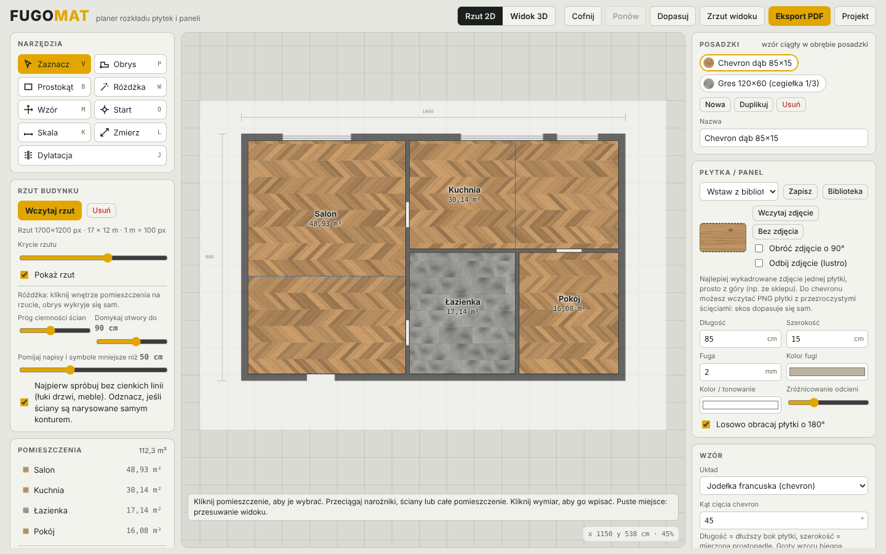
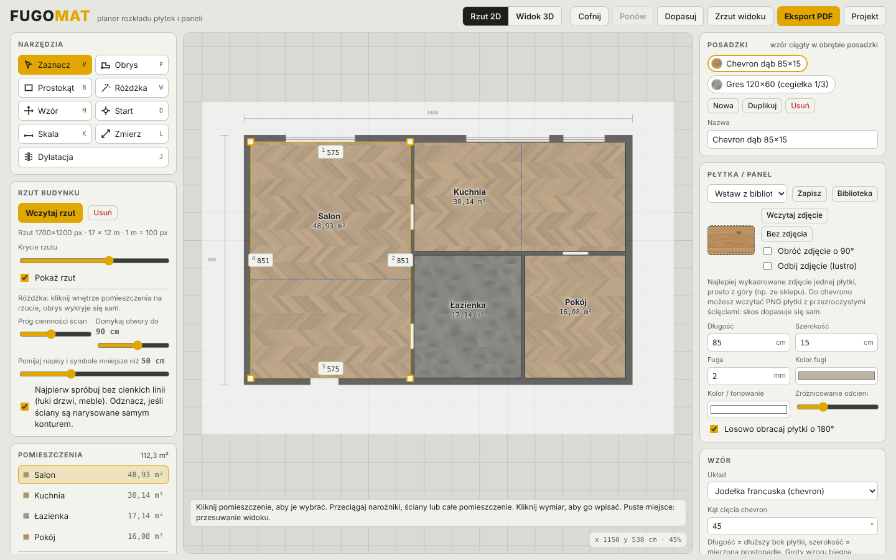
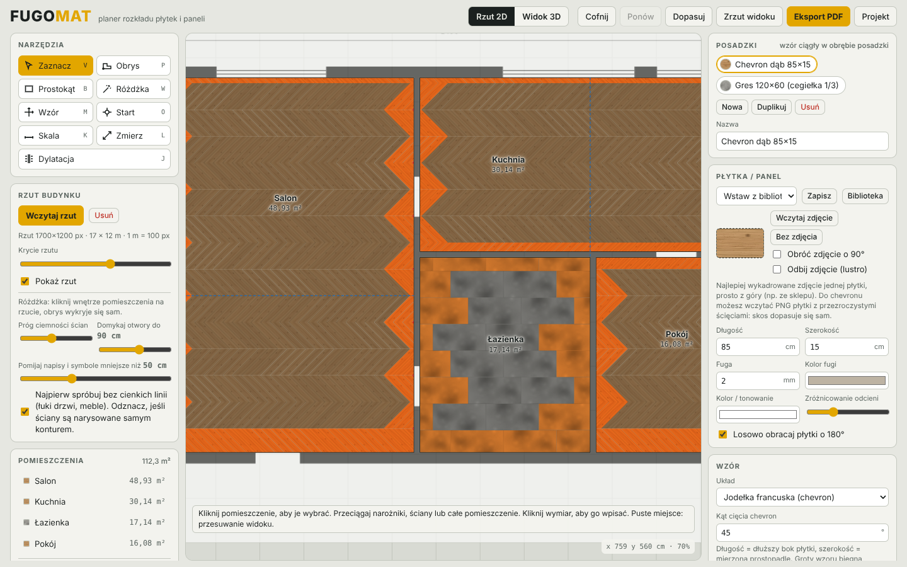
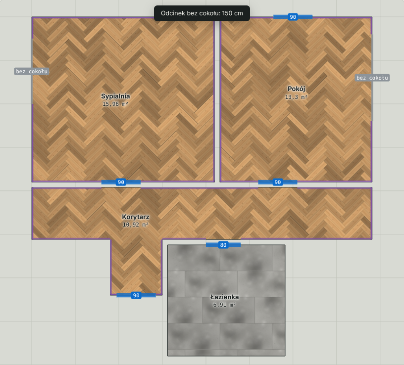
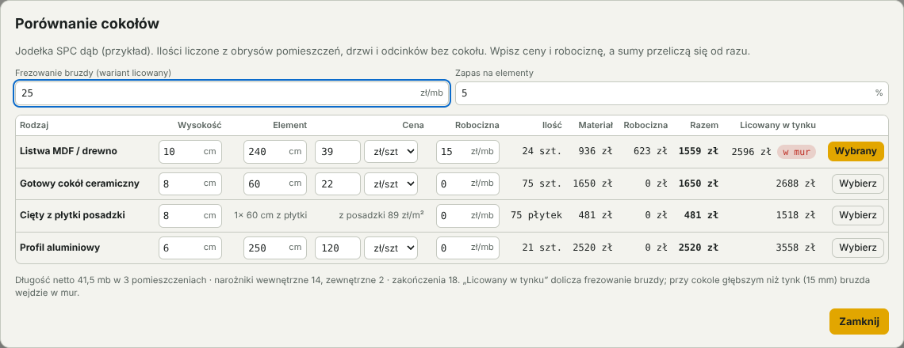
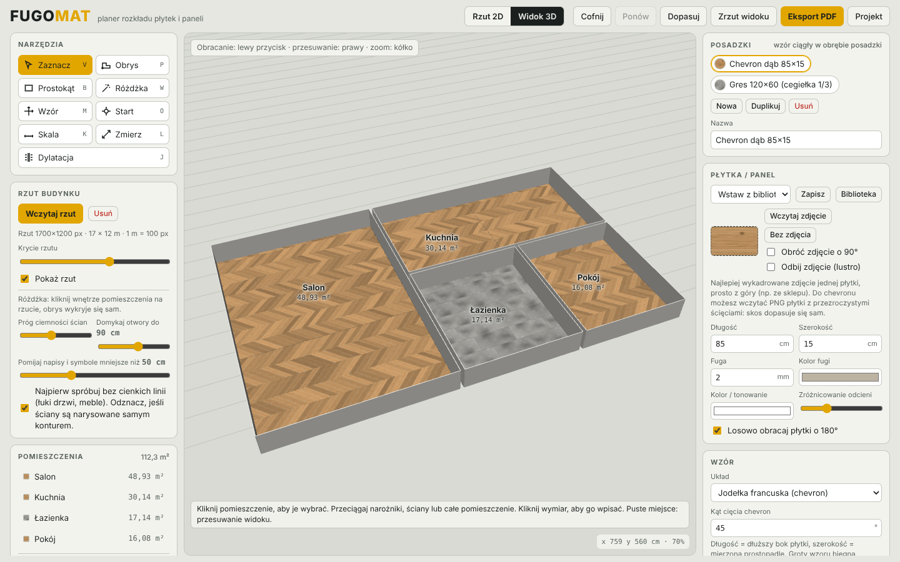
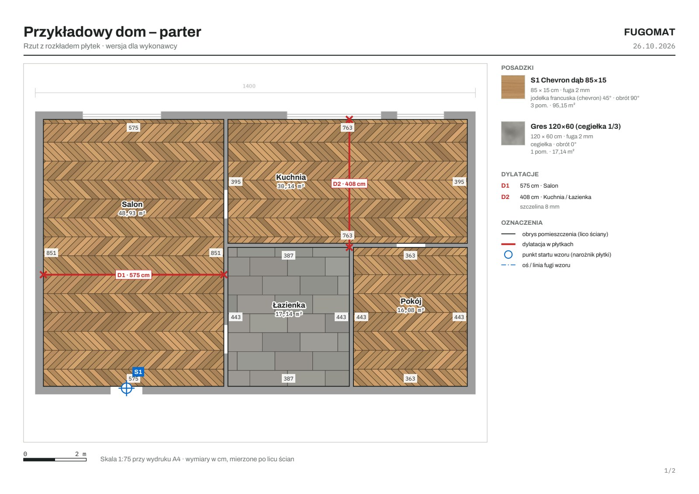
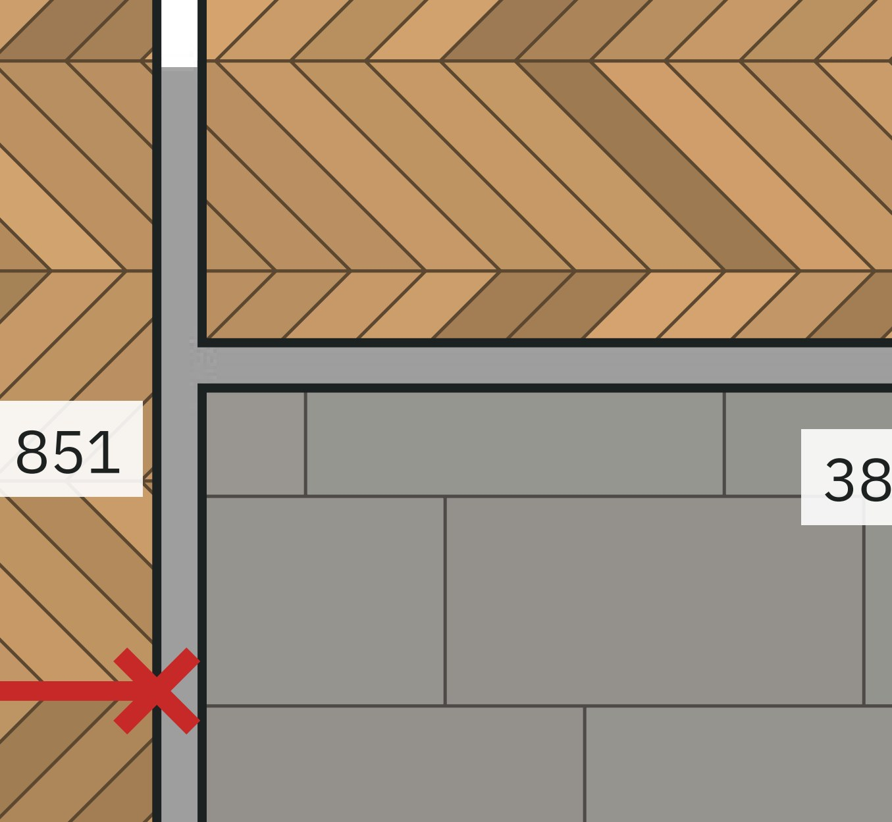
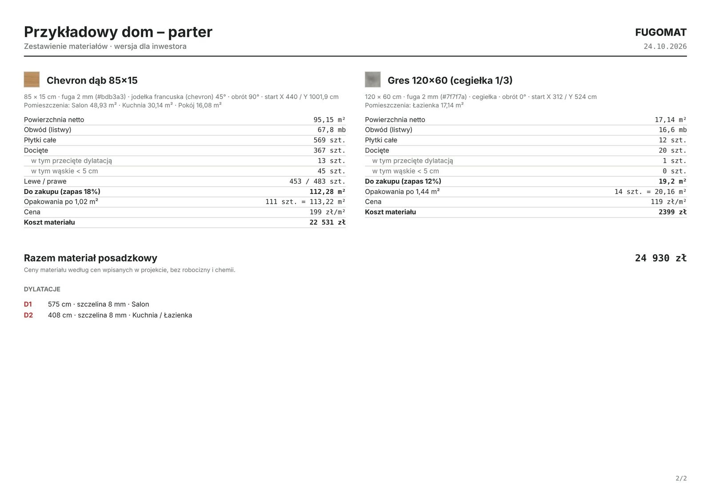
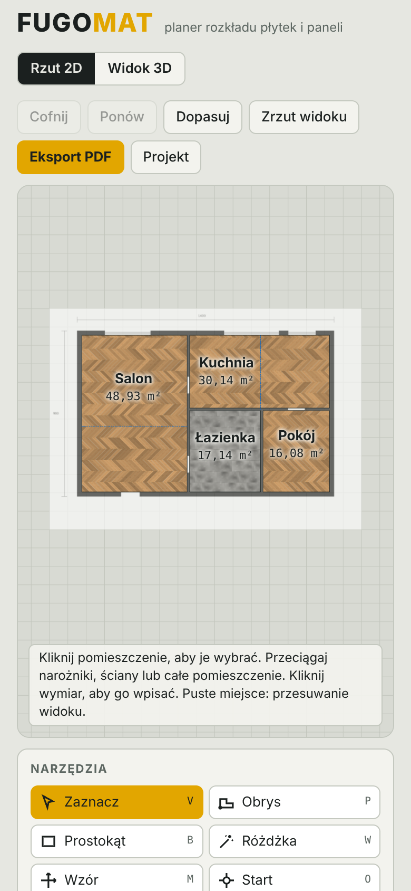

# Fugomat

Planer rozkładu płytek i paneli na rzucie domu. Wczytujesz rzut, obrysowujesz pomieszczenia, wybierasz płytkę i wzór, a potem przesuwasz i obracasz wzór, aż docinki przy ścianach i w przejściach wyjdą tak, jak chcesz. Działa w przeglądarce, bez instalacji i bez serwera.

**[Otwórz Fugomat](https://mikebronka.github.io/fugomat/)**

## Jak to działa

1. **Wczytaj rzut**: JPG, PNG albo PDF. Dla PDF-a z programu CAD wystarczy podać skalę rysunku (np. 1:50) i skala ustawia się sama. Skan kalibrujesz, klikając dwa punkty o znanej odległości.
2. **Obrysuj pomieszczenia**: różdżką (klik we wnętrze pokoju), ręcznie (narożnik po narożniku, z wpisywaniem długości) albo prostokątem.
3. **Popraw wymiary**: kliknij wymiar ściany i wpisz właściwą długość. Sąsiednia ściana przesuwa się razem z nią, więc obrys zostaje prostokątny.
4. **Wybierz płytkę i wzór**: wymiar, fuga, kolory, zdjęcie płytki albo gotowa pozycja z biblioteki płytek.
5. **Ustaw wzór**: przeciągnij go, obróć, ustaw punkt startu (np. oś drzwi wejściowych) albo pozwól programowi poszukać ułożenia bez wąskich docinek.
6. **Dodaj dylatacje** w miejscach dylatacji wylewki i zobacz, które płytki przetną.
7. **Wyeksportuj PDF**: wersję dla inwestora z wyceną albo techniczną dla wykonawcy.

## Wzory

- prosto (siatka),
- cegiełka z przesunięciem 1/2, 1/3 lub 1/4,
- deski z losowym przesunięciem łączeń (z minimalnym odstępem),
- jodełka klasyczna,
- jodełka francuska (chevron) z dowolnym kątem cięcia, z osobnym liczeniem płytek lewych i prawych.

Pomieszczenia z tą samą posadzką mają jeden ciągły wzór, tak jak przy układaniu bez progów przez kilka pokoi.

## Rzut, różdżka i wymiary

Różdżka wykrywa obrys pokoju z rysunku: domyka otwory drzwiowe, pomija napisy, łuki drzwi i meble, a cienkie linie okien traktuje jak ścianę. Jeśli obszar „wycieknie” przez szeroki otwór, sama próbuje mocniejszego domykania. Wynik zawsze warto sprawdzić, bo każdy wymiar da się poprawić ręcznie.

- przeciąganie narożników i całych ścian, z przyciąganiem do 90° i do narożników sąsiednich pomieszczeń,
- wpisywanie długości każdej ściany,
- skalowanie całego obrysu do podanego gabarytu,
- „Wyprostuj do 90°” dla obrysów lekko krzywych po imporcie.

## Docinki i dylatacje

Podgląd docinek (klawisz C) koloruje płytki docięte, a na czerwono te węższe niż ustawiony próg (domyślnie 5 cm). Przycisk „Szukaj ułożenia bez wąskich docinek” przeszukuje setki przesunięć wzoru i wybiera najlepsze.

Dylatacje rysuje się od ściany do ściany. Szczelina tnie płytki, a zestawienie podaje, ile sztuk przecina. Przycisk „do fugi” przesuwa wzór tak, żeby dylatacja biegła po linii fugi, jeśli wzór na to pozwala. Przy chevronie da się tak schować dylatację biegnącą wzdłuż osi grotów. Poprzeczna zawsze przetnie płytki.

## Cokoły

Dla każdej posadzki wybierasz rodzaj cokołu i montaż, a program liczy ilości i koszty:

- **rodzaje**: listwa MDF / drewno, gotowy cokół ceramiczny, cokół cięty z płytki posadzki, profil aluminiowy,
- **montaż**: nawierzchniowy albo licowany w tynku (z głębokością bruzdy i ostrzeżeniem, gdy bruzda wchodzi głębiej niż tynk),
- **drzwi** (klawisz D) i **odcinki bez cokołu** (klawisz N, np. za zabudową kuchni) zaznacza się na ścianach; drzwi wycinają cokół po obu stronach ściany,
- pomieszczenie można całkiem wyłączyć z cokołu (np. łazienkę z płytkami na ścianach).

Wynik: długość netto w mb, liczba elementów z rozkrojem (odpady z jednej ściany idą na inną), narożniki wewnętrzne i zewnętrzne, zakończenia przy drzwiach, styki. Przy cokole ciętym z płytki: ile pasków wychodzi z jednej płytki (także z płytki chevron, ze ściętymi końcami), ile płytek dokupić i ile opakowań razem z posadzką.

Okno „Porównaj rodzaje cokołów” zestawia wszystkie warianty obok siebie: wpisujesz ceny i robociznę, a od razu widzisz ilość, materiał, robociznę, sumę i koszt wariantu licowanego.

## Widok 3D

## Eksport PDF

Dwie wersje do wyboru w oknie eksportu:

- **dla inwestora**: rzut z ułożeniem, ceny, koszt materiału i suma,
- **dla wykonawcy**: bez kwot, z wymiarami ścian, dylatacjami (długości, pomieszczenia), cokołami, drzwiami i odcinkami bez cokołu, punktem startu wzoru z odległościami od ścian, osią wzoru i uwagami wykonawczymi.

PDF jest wektorowy: każda płytka, docinka, fuga, dylatacja, wymiar i napis to krzywe, a nie obraz. Przy dowolnym powiększeniu widać nawet kilkucentymetrowe docinki, a tekst da się zaznaczyć i skopiować. Płytki mogą być w kolorze (lekki plik, najczytelniej) albo ze zdjęciem płytki i wektorowymi krawędziami.

Rzut z rysunku idzie w tle na jasnoszaro, a skala dobiera się do okrągłej wartości (1:50, 1:75, 1:100…). Format A4 albo A3, do wyboru też sam rzut jako PNG.

Zbliżenie fragmentu tego samego PDF-a:

## Zestawienie materiałów

Dla każdej posadzki: powierzchnia netto, obwód pod listwy, płytki całe i docięte (w tym przecięte dylatacją i wąskie), lewe/prawe przy chevronie, ilość do zakupu z zapasem, liczba opakowań i koszt.

## Biblioteka płytek

Raz wpisaną płytkę (wymiar, fuga, kolory, wzór, zdjęcie, opakowanie, cena) zapisujesz w bibliotece i wstawiasz w każdym projekcie jednym kliknięciem. Bibliotekę można zapisać do pliku i wczytać na innym komputerze.

## Na telefonie

## Skróty klawiszowe

| Klawisz | Działanie |
|---|---|
| V | zaznacz / edytuj |
| P | rysuj obrys (liczba + Enter = długość ściany) |
| B | prostokąt |
| W | różdżka |
| M | przesuń wzór (strzałki: 1 cm, Shift: 10 cm) |
| O | punkt startu wzoru |
| J | dylatacja |
| D | drzwi (przerwa w cokole) |
| N | odcinek bez cokołu |
| K | kalibracja skali |
| L | zmierz |
| [ ] | obrót wzoru o 1° (Shift: 15°) |
| C | podgląd docinek |
| T | półprzezroczysta posadzka |
| F | dopasuj widok |
| Ctrl+Z / Ctrl+Y | cofnij / ponów |

## Zapis danych

Projekt zapisuje się automatycznie w pamięci przeglądarki, na tym komputerze. Nic nie jest wysyłane na serwer, więc rzuty i zdjęcia zostają u Ciebie. Każdy, kto otworzy stronę, ma własne, osobne projekty. Żeby przenieść projekt albo go komuś wysłać, zapisz go do pliku `.json` (Projekt → Zapisz plik .json) i wczytaj po drugiej stronie.

## Uruchomienie

Wystarczy otworzyć `index.html` w przeglądarce (potrzebny jest internet, bo biblioteki ładują się z CDN).

Własna kopia na GitHub Pages: Settings → Pages → Deploy from a branch → `main` / root.

Wykorzystane biblioteki: [three.js](https://threejs.org/), [Clipper](https://sourceforge.net/projects/jsclipper/), [jsPDF](https://github.com/parallax/jsPDF), [PDF.js](https://mozilla.github.io/pdf.js/). Fonty osadzane w PDF: [Archivo](https://fonts.google.com/specimen/Archivo) i [IBM Plex Mono](https://fonts.google.com/specimen/IBM+Plex+Mono) (SIL Open Font License).

## Zastrzeżenie

Wyniki są pomocnicze. Przed zamówieniem płytek sprawdź wymiary na budowie, kąt cięcia płytek chevron i miejsca dylatacji wylewki. Decyzje wykonawcze uzgodnij z wykonawcą.
